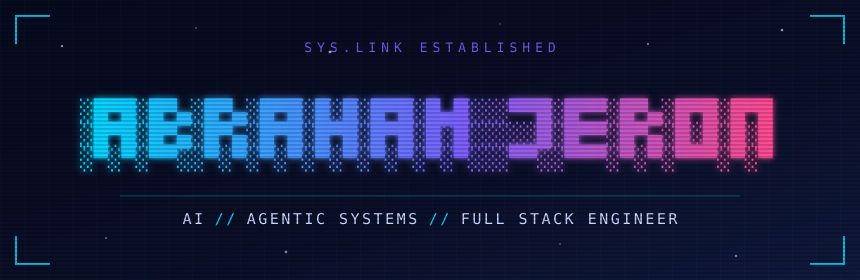

  

 

### `[ ARSENAL ]`

`▰▰▰▰▰▰▰▰▰▰` **LANGUAGES**

`▰▰▰▰▰▰▰▰▰▰` **AI & LLM SYSTEMS**

`▰▰▰▰▰▰▰▰▱▱` **FRONTEND**

`▰▰▰▰▰▰▰▰▱▱` **BACKEND · DATA**

`▰▰▰▰▰▰▱▱▱▱` **CLOUD · TOOLING**

---

### `[ SYSTEM STATUS ]`

### `[ TELEMETRY ]`

 

`▰▱▰▱▰▱▰▱▰▱▰▱▰▱▰▱▰▱▰▱▰▱▰▱▰▱▰▱▰▱▰▱▰▱▰▱▰▱▰▱`

*"All those moments will be lost in time, like tears in rain."* — Roy Batty, **Blade Runner** (1982)

`> connection closed. ship safe.`

